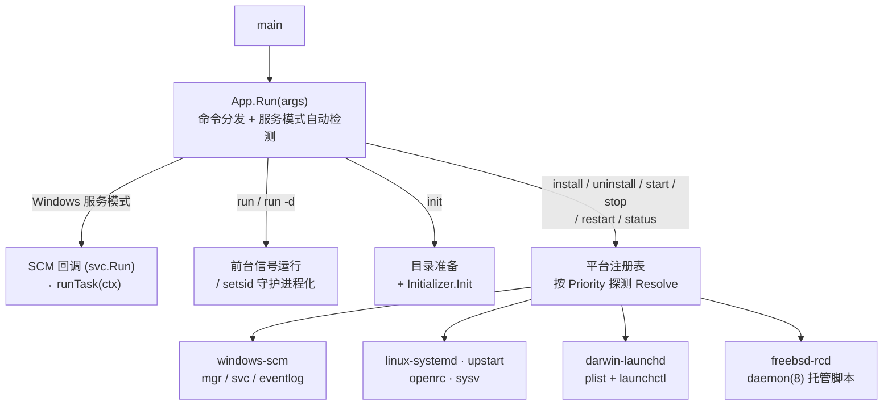

<div align="center">

# go-service

**跨平台系统服务组件 —— 一个二进制同时是服务本体与控制工具**

基于 Go 实现的任意程序**直接运行、注册为系统服务、卸载服务**，统一覆盖 Windows / Linux / macOS / FreeBSD 的主流 init 系统。


**[快速开始](#-快速开始) · [平台支持](#-平台支持) · [命令说明](#-命令说明) · [配置选项](#-服务配置选项) · [扩展平台](#-扩展新平台) · [架构](#-架构)**

</div>

---

## ✨ 特性

- 🔁 **一个二进制，三种角色** —— 前台程序、后台守护进程、系统服务
- 🎯 **标准执行参数** —— `init` / `run` / `start` / `stop` / `restart` / `install` / `uninstall`，外加 `status` / `version` / `help`
- 🔍 **平台自动检测** —— 运行时按优先级探测 init 系统，无需编译期指定
- 🪶 **零第三方依赖** —— 仅 `golang.org/x/sys`，单文件交叉编译到全平台
- 🧱 **注册表模式扩展** —— 新增平台只需实现 `Platform` 接口并 `Register`，业务任务只需最小接口 `Task`
- 📝 **模板可覆盖** —— unit / init.d / plist 服务文件支持自定义模板
- 🌙 **守护进程化** —— POSIX 下 `run -d` 一键后台化：setsid 分离 + PID 文件管理 + 日志重定向 + 优雅退出

## 🖥️ 平台支持

| 平台 | 标识 | 注册位置 | 控制方式 |
|---|---|---|---|
| Windows SCM | `windows-scm` | 服务控制管理器 | `svc` / `mgr`，日志入事件日志 |
| Linux systemd | `linux-systemd` | `/etc/systemd/system/*.service` | `systemctl`，journal 捕获输出 |
| Linux Upstart | `linux-upstart` | `/etc/init/<name>.conf` | `initctl` |
| Linux OpenRC | `linux-openrc` | `/etc/init.d/<name>`（openrc-run） | `rc-service` |
| Linux SysV | `linux-sysv` | `/etc/init.d/<name>`（薄脚本代理 daemon 子命令） | init 脚本 |
| macOS launchd | `darwin-launchd` | `/Library/LaunchDaemons` 或 `~/Library/LaunchAgents` | `launchctl` |
| FreeBSD rc.d | `freebsd-rcd` | `/usr/local/etc/rc.d/<name>`（daemon(8) 托管） | `service` |

## 🚀 快速开始

### 1️⃣ 编写程序

```go
package main

import (
    "context"
    "fmt"
    "os"
    "time"

    goservice "github.com/hicode0101/go-service"
)

type worker struct{}

func (w *worker) Run(ctx context.Context) error {
    for {
        select {
        case <-ctx.Done():
            return nil // 收到停止信号，尽快退出
        case <-time.After(time.Second):
            // 业务逻辑
        }
    }
}

func main() {
    app, err := goservice.New(
        goservice.WithName("myapp"),
        goservice.WithDisplayName("My Application"),
        goservice.WithDescription("my first service"),
        goservice.WithTask(&worker{}),
    )
    if err != nil {
        fmt.Fprintln(os.Stderr, err)
        os.Exit(1)
    }
    if err := app.Run(os.Args[1:]); err != nil {
        fmt.Fprintln(os.Stderr, err)
        os.Exit(1)
    }
}
```

### 2️⃣ 编译与服务管理

```bash
go build -o myapp .

# 直接运行
./myapp                # 等价于 ./myapp run，Ctrl+C 优雅退出
./myapp run -d         # POSIX 下后台运行（守护进程化）

# 初始化环境（幂等：建目录 + 调用任务 Init）
./myapp init

# 服务管理（需要管理员/root）
sudo ./myapp install   # 注册为系统服务（自动检测平台，注册前先执行一次 init）
sudo ./myapp start     # 通过服务管理器启动
./myapp status         # 查看状态
sudo ./myapp restart
sudo ./myapp stop
sudo ./myapp uninstall # 卸载服务

./myapp version
./myapp help
```

Windows 下（管理员 PowerShell）：

```powershell
.\myapp.exe install
.\myapp.exe start
.\myapp.exe status
```

## 📖 命令说明

| 命令 | 说明 |
|---|---|
| `init` | 初始化运行环境：创建工作/日志目录，调用任务的 `Init` 回调（幂等） |
| `run` | 前台运行（默认命令，无参数时执行）；`-d/--daemonize` 转后台（POSIX） |
| `start` | 通过服务管理器启动已注册服务 |
| `stop` | 停止服务 |
| `restart` | 重启服务 |
| `install` | 注册为系统服务（写入平台服务文件/注册表）。**注册前会先执行一次 Init 初始化**，确保目录/配置随部署就绪 |
| `uninstall` | 卸载服务（先停止再移除） |
| `status` | 查看服务状态与平台标识 |
| `version` / `help` | 版本与帮助 |
| `daemon <start\|stop\|restart\|status>` | 内部子命令：进程级守护管理（SysV/rc.d 脚本代理到此，也可直接使用） |

## 🧩 任务接口

只需实现最小接口，其余按需组合：

```go
// 必须实现：业务主体，阻塞运行，监听 ctx 退出
type Task interface {
    Run(ctx context.Context) error
}

// 可选：初始化（init 命令时调用；install 注册服务前也会执行一次。
// 要求幂等；run 与服务启动不会触发）
type Initializer interface {
    Init(a *App) error
}

// 可选：停止钩子（ctx 取消后的最后清理机会）
type StopHook interface {
    Stop() error
}

// 可选：启动前回传 App（读取配置与日志器）
type Configurable interface {
    Configure(a *App)
}
```

适配函数也支持：`goservice.WithTask(goservice.TaskFunc(func(ctx) error { ... }))`。

### Init 回调的幂等要求

**幂等（idempotent）**：同一操作执行一次和执行多次，结果完全相同——重复调用不会产生副作用累积。

Init 只在 `myapp init` 与 `myapp install` 两个命令中被调用（run 与服务启动不触发），但这两个命令都可能被重复执行（运维重跑、部署脚本重复调用），组件不拦截重复调用、也不做状态跟踪，因此 `Init` 实现必须保证"跑 N 遍 = 跑 1 遍"：

```go
// ✅ 幂等：重复执行结果不变
func (t *myTask) Init(a *goservice.App) error {
	// MkdirAll 目录已存在时静默成功
	os.MkdirAll("/var/lib/myapp", 0o755)

	// 配置文件不存在才写入，避免覆盖用户修改
	if _, err := os.Stat("config.json"); os.IsNotExist(err) {
		os.WriteFile("config.json", defaultConfig, 0o644)
	}
	return nil
}

// ❌ 非幂等：重复执行产生累积副作用
func (t *myTask) Init(a *goservice.App) error {
	os.WriteFile("config.json", defaultConfig, 0o644) // 第二次会把用户改过的配置覆盖回默认值
	db.Exec("INSERT INTO init_log ...")               // 第二次插入重复记录
	users = append(users, adminUser)                  // 第二次多出一个管理员
	return nil
}
```

常见幂等写法：

| 操作 | 非幂等 | 幂等写法 |
|---|---|---|
| 创建目录 | `os.Mkdir`（已存在时报错） | `os.MkdirAll`（已存在时跳过） |
| 写默认配置 | 直接 `WriteFile` | 先 `Stat` 判断不存在才写 |
| 数据库初始化 | `INSERT` | `CREATE TABLE IF NOT EXISTS` / `ON CONFLICT DO NOTHING` |
| 资源准备 | 每次新建 | 已存在则复用 |

组件自身的默认行为已满足幂等（目录用 `MkdirAll`、daemon 日志用追加写），完整示例见 [`example/demo`](./example/demo/main.go) 的 `Init` 实现：连续执行两次 `demo init`，第二次只输出 "config already exists ... skipped"。

## ⚙️ 服务配置选项

构造 App 时通过 `WithOptions(map[string]any)` 传入平台选项：

| 键 | 平台 | 说明 |
|---|---|---|
| `StartType` | Windows | `automatic` / `manual` / `disabled`（默认 automatic） |
| `DelayedAutoStart` | Windows | 延迟自启动 |
| `OnFailure` | Windows | 失败恢复：`restart` / `reboot` / `noaction` |
| `OnFailureDelayDuration` | Windows | 恢复延迟（默认 `1s`） |
| `OnFailureResetPeriod` | Windows | 失败计数重置周期秒数（默认 10） |
| `Password` / `Interactive` | Windows | 账户密码 / 可交互服务 |
| `UserService` | systemd/launchd | 安装为用户级服务（user unit / LaunchAgents） |
| `LogDirectory` | POSIX | 日志目录（默认 `/var/log`） |
| `LimitNOFILE` | systemd | 最大打开文件数（-1 不设置） |
| `Restart` / `RestartSec` | systemd | 重启策略与延迟（默认 `on-failure` / `5s`） |
| `SystemdUnit` | systemd | 自定义 unit 文件模板（Go text/template） |
| `KeepAlive` / `RunAtLoad` | launchd | 崩溃自动拉起 / 加载即启动（默认 true） |
| `PIDFile` | daemon/rc.d | 自定义 PID 文件路径 |

其他 App 选项：`WithArguments`（run 附加参数）、`WithDependencies`、`WithWorkingDirectory`、`WithUserName`、`WithExecutable`、`WithEnvVars`、`WithLogger`、`WithStopTimeout`（优雅退出超时，默认 10s）。

## 🔌 扩展新平台

实现 `Platform` 接口后注册即可，组件运行时按 `Priority` 从小到大调用 `Detect`：

```go
type myPlatform struct{}

func (myPlatform) Name() string      { return "my-platform" }
func (myPlatform) Detect() bool      { return detectMyInit() }
func (myPlatform) Interactive() bool { return true }
func (myPlatform) Install(c *goservice.Config) error   { /* 写配置文件 */ }
func (myPlatform) Uninstall(c *goservice.Config) error { /* 删配置文件 */ }
func (myPlatform) Start(c *goservice.Config) error     { /* 调用平台工具 */ }
func (myPlatform) Stop(c *goservice.Config) error      { /* ... */ }
func (myPlatform) Restart(c *goservice.Config) error   { /* ... */ }
func (myPlatform) Status(c *goservice.Config) (goservice.Status, error) { /* ... */ }

func init() {
    goservice.Register(&goservice.Definition{
        Priority: 50,
        Detect:   myPlatform{}.Detect,
        New:      func() goservice.Platform { return myPlatform{} },
    })
}
```

## 🏗️ 架构



**数据面与控制面分离**：业务运行统一在前台（systemd `Type=simple` / launchd `ProgramArguments` / SCM 回调 / daemon setsid 子进程），所有平台共享同一套信号处理与优雅退出逻辑；平台实现只做控制面（注册、启停、状态），代码互不干扰。

<details>
<summary>📁 源码目录结构</summary>

```
go-service/
├── service.go                  # 包文档、Status、命令常量、Config、错误定义
├── task.go                     # Task 最小接口 + Initializer/StopHook/Configurable 可选接口
├── registry.go                 # Platform 接口 + 注册表（Register/Resolve）
├── app.go                      # App 组件：CLI 命令分发 + 任务生命周期调度
├── logger.go                   # Logger 接口 + 控制台/按天滚动文件日志
├── daemon_unix.go              # POSIX 守护化：setsid 分离 + PID 文件管理
├── daemon_windows.go           # Windows 降级（提示用 install + start）
├── runmode_windows.go          # Windows 服务模式自动检测
├── runmode_other.go            # 非 Windows：统一走前台运行
├── cmdutil.go                  # 外部命令执行、路径助手
├── platform_windows.go         # Windows SCM：svc/mgr/eventlog/恢复策略/注册表环境变量
├── platform_systemd_linux.go   # systemd：unit 模板 + systemctl
├── platform_sysv_linux.go      # SysV：init.d 薄脚本 → 代理 daemon 子命令
├── platform_openrc_linux.go    # OpenRC：openrc-run 脚本 + rc-service
├── platform_upstart_linux.go   # Upstart：conf + initctl
├── platform_launchd_darwin.go  # macOS：plist + launchctl
├── platform_rcd_freebsd.go     # FreeBSD：daemon(8) 托管脚本
└── example/demo/main.go        # 完整示例：Initializer/Configurable/StopHook 组合
```

</details>

---

<div align="center">

**go-service** © 2026 · [MIT License](./LICENSE)

<sub>灵感与致敬：[kardianos/service](https://github.com/kardianos/service)</sub>

</div>
